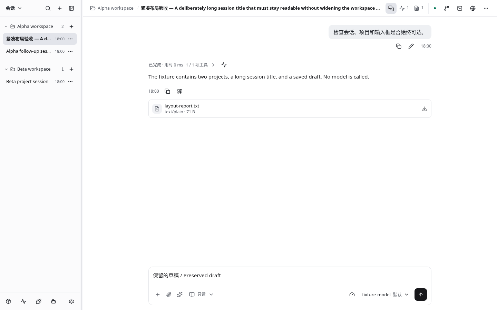

# 紧凑工作台布局

## 范围与基线

- 用户要求：按已确认的设计图实现布局，从最新 `main` 新建分支。
- 基线：`28981393991d2e34edaae725e06d19123b568b61`；开始实施及交付前读取远端 `main` 均为该提交。
- 分支：`feat/compact-workbench-layout`。
- 变更在渲染器布局、控件呈现、中英文词条和验收脚本；复用既有路由、Query/Redux 状态、面板协议、权限及持久化机制。

## 布局与交互

1. 侧栏以 48 px 工具栏开头，保留会话/项目菜单、搜索、新建和收起。项目与会话树紧随其后；交付物、执行记录、扩展、智能体和设置放在底部图标栏。
2. 搜索替换工具栏，不新增一行。Escape 清空并关闭搜索、恢复触发器焦点；收起侧栏同时清除不可见筛选。普通空闲会话不显示圆点，运行、审批和未读结果仍保留状态。
3. 标题只在工作台顶栏出现一次。项目名称继续作为工作空间管理入口；会话、执行轨迹、交付物使用图标标签，保留键盘切换、计数与本地化无障碍说明。浏览器独占窄内容区时隐藏不存在的会话面板标签。
4. Git、终端和浏览器使用图标按钮，保留开关状态和焦点引用；前进、后退归入更多导航菜单。工作树恢复、Agent 升级、分支来源等有条件上下文保留。
5. 成功运行使用紧凑状态摘要，移除重复的大结果卡；失败仍有错误、重试和轨迹入口。文件在会话中以紧凑行呈现，其他交付物页面沿用原卡片。输入区精简图标，但模式、模型名称与关键状态继续显示文字。

## 验证命令

原 `tsx` CLI 在当前执行环境创建 Unix IPC 管道时失败（`listen EPERM /tmp/tsx-1000/…pipe`）。使用下列等价入口执行相同源码，没有修改安全设置或项目脚本绕过检查：

```bash
node --import tsx packages/markdown/scripts/build-css-types.mts
node --import tsx scripts/check-architecture.mts
node --import tsx scripts/check-query-boundaries.mts
node --import tsx scripts/check-i18n.mts
node --import tsx scripts/check-ui.mts --self-test
node --import tsx scripts/check-ui.mts
node node_modules/typescript/bin/tsc --noEmit
node node_modules/typescript/bin/tsc -p frontend/tsconfig.json
node node_modules/typescript/bin/tsc -p tsconfig.desktop.json
node node_modules/typescript/bin/tsc -p tsconfig.tools.json
npm run test:frontend
npm run prepare:preview
npm --ignore-scripts run build
node --import tsx scripts/smoke-compact-layout.mts
```

Markdown 的 Vite 与 TypeScript 构建已成功，只有其最后的 `tsx` CLI 后处理需要上述 loader 入口。前端构建因此跳过重复的 npm lifecycle，预处理单独执行。构建保留仓库原有的大于 500 kB chunk 提示。

架构、Query 边界、i18n、UI 语义及四组 TypeScript 检查通过；前端测试 **125 通过、0 失败、15 跳过**，15 项需要系统 Chromium。当前环境无系统 Chromium，另外使用仓库的 Electron 验证实际渲染器。完整输出见 [检查](checks.txt)、[前端测试](frontend-tests.txt)和[构建](build.txt)。

## 真实渲染器验收

使用 `scripts/smoke-compact-layout.mts` 加载实际 `frontend/src/main.tsx`、工作台和功能组件，在开启渲染器沙箱的真实 Electron 窗口中操作，HTTP、原生浏览器桥和会话数据使用隔离夹具。改变实际窗口尺寸，不用替换组件或截图拼图代替页面。

验收矩阵为简体中文和英文，各覆盖 1280×800、1440×900、1920×1080；补充 800 px 浏览器独占和侧栏收起场景。六组全部通过，页面错误、夹具服务错误、未预期 API 请求均为 0，运行前后源码摘要一致。完整记录见 [result.json](result.json)。

首次截图发现旧的未分层 `.conversation-screen` 网格规则覆盖了组件层内的新规则，消息区仅 48 px 高。新增几何断言后六个场景均准确失败。修复将当前网格行定义统一到工作台有效样式层，保留一行正文或上下文加正文两行。该断言检查消息区实际高度及输入框底部位置，防止只验证点击成功而遗漏整体布局。

| 语言 | 窗口 | 检查组 | 消息区高度 | 输入框底部 |
| --- | --- | ---: | ---: | ---: |
| 简体中文 | 1280×800 | 12 | 616 px | 800 px |
| 简体中文 | 1440×900 | 11 | 716 px | 900 px |
| 简体中文 | 1920×1080 | 11 | 896 px | 1080 px |
| English | 1280×800 | 12 | 616 px | 800 px |
| English | 1440×900 | 11 | 716 px | 900 px |
| English | 1920×1080 | 11 | 896 px | 1080 px |

全部场景顶栏 48 px、侧栏 232 px、首条会话顶部 95.828 px。覆盖内联搜索及焦点恢复、项目与会话切换、底部入口、收起和展开、键盘标签导航、草稿/模式/模型保留，以及终端与浏览器关闭后的焦点返回。新增成功工具与文件夹具核对单条摘要、紧凑文件行和无重复结果卡；失败运行核对错误和可用的重试、轨迹入口。未触发实际重试、工具执行或下载。



另见 [英文 1280×800](en-1280x800.png) 和 [侧栏收起](zh-CN-collapsed.png)。

## 全量运行时测试的限制

`npm test` 的运行时部分和增加 Node 测试超时的诊断运行均无法完成；主会话中止挂起进程，退出码 130。不能将本轮全量测试记为通过。

最小复现：

```bash
timeout -k 2 25 node --import tsx --test --test-reporter=spec tests/harness-process.test.ts
```

该用例文件得到 10 通过、1 失败、1 取消，外部超时退出 124。失败为 `observed detached shell session and reparented grandchild are also cleaned`：等待重新托管的孙进程消失时，4 秒后断言失败，遗留进程使测试 worker 不退出。当前环境可读 `/proc/self/stat`，但缺少 `/proc/<pid>/task/<tid>/children`；现有后代采样在该路径不存在时跳过。此问题涉及 Node 子进程和 `/proc`，与前述 `tsx` Unix IPC 限制不同。

运行时实现和此测试均未在本分支修改。应在提供完整 Linux `/proc` 进程树信息的环境复跑该用例与 `npm test`。失败摘录及说明见 [窄测记录](runtime-harness-process-repro.txt)。

完整生产 Electron main 的单实例锁同样受当前 Unix socket 权限限制；此次没有关闭沙箱或移除单实例锁。渲染器验收不等同于生产 main、实际模型、PTY、安装包和用户日用数据的端到端验收，也没有切换用户正在使用的桌面实例。

## 文件说明与远端交付

本地功能验收提交为 `3291ceb0ec6add28893131cdac94fccd02440ad5`。按仓库要求使用 `gpt-6.1-terra` / `xhigh` 做一次只读文件说明复核，18 份输入均记录 SHA-256；主会话核对文件未变化后应用 3 份必要建议，其余 15 份维持原说明。末尾仅做 Prettier 格式和文件头维护，未改变已验收行为。

终端未配置 GitHub HTTPS 推送凭据，远端提交通过已连接的 GitHub 插件写入同一文件树。提交作者/时间可能使远端 commit ID 与本地不同；交付时核对完整 Git tree SHA 与本地一致，确保源码及截图内容相同。

## Review 与回退

独立审查后修复窄窗口中不存在的面板仍显示标签的问题，并补齐项目名称、计数的无障碍说明及图标提示。源码检查、截图和几何检查分别覆盖结构、交互与实际空间分配。

开发过程 review：优先复用现有类型检查和前端行为测试。实际截图比只看点击断言更早暴露 CSS 层叠问题，今后布局烟测应先校验核心区域几何。全量测试无进展时，用单文件、有外部超时的复现定位到未改动的进程回收用例，停止重复运行全量；环境能力与本功能的渲染器验收分开记录。

回退：撤销本布局提交即可恢复原控件布局；本分支不包含数据库、API 或持久化格式迁移。
