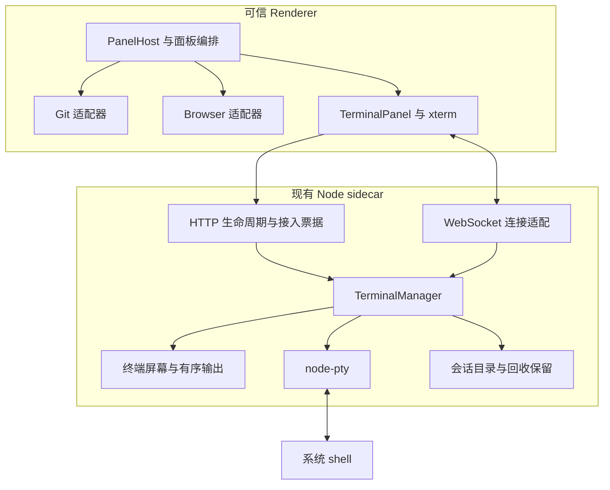

# Atelier 工作台扩展与终端嵌入 Implementation Plan

> **For agentic workers:** REQUIRED SUB-SKILL: Use superpowers:subagent-driven-development or superpowers:executing-plans to implement this plan task-by-task. 使用下方 checkbox 跟踪，不跳过真实桌面与安装件验证。

**Goal:** 在现有工作台中加入会话绑定的交互终端，以 Terminal 验证可复用的面板接入契约，并为以后 Agent 编写、安装插件保留明确接口。

**Architecture:** 复用现有 WorkspacePanels、React/TypeScript、TanStack Query、Redux Toolkit、Node sidecar 和 Electron 配对边界。面板宿主管功能选择、布局和呈现；Terminal feature 管终端标签与 xterm；sidecar 管 PTY、屏幕状态、会话归属和清理。HTTP 管生命周期，WebSocket 管交互流。

**Tech Stack:** 现有 React 19.3.1、TypeScript 7.0.2、Zod 4.6.7、TanStack Query 5.108.4、Redux Toolkit 2.14.0、react-resizable-panels 4.24.2、Electron 45.4.1；新增 xterm 6 同代组件、node-pty 1.1.0、ws 8.23.0。安装态执行宿主为随包 Node 24.21.0。

**Spec:** 本文第 1–10 节为技术设计和范围约束，第 11–13 节为实施任务、验收和回退。建议执行时将设计摘要登记到 `docs/decisions/2026-11-26-terminal-workbench.md`，将本文放到 `docs/superpowers/plans/2026-11-26-terminal-workbench.md`。2026-11-26 用户授权开发，本方案随实现更新。

## Global Constraints

- 实施基线：`CoderLambert/atelier-handoff`，远程 `main`，`f48da53dd842e2176fdb3f2cfee96721a9d723fd`；提交时间为 2026-11-25 22:56:03（北京时间）。开发分支 `feat/terminal-workbench`。原调研基线 `3b7f45d` 保留为历史来源。
- 设计约束与实际验证分开记录。最终执行结果见阶段日志与验收证据；未运行的桌面或安装件门槛不得以静态检查代替。
- 首期支持已配对的 Linux x64 桌面，并尊重既有 nativeExecution 能力总开关；不修改会话的 Agent 执行模式。Web 开发窗口及其他平台由能力接口明确标记 Terminal 不可用。保留已有 Windows/macOS 非 Terminal 候选构建能力。
- 可执行源码严格 TypeScript；所有外部边界从 unknown 经 Zod 校验；共享协议以一份 schema 推导；不以 any 或关闭检查绕过类型约束。
- 前端每个 HTTP API 操作一个 use-query hook；业务编排归 feature hook；字节流不进入 Redux、Query 缓存、RunEvent SSE 或 SQLite。
- 中文/英文应用文案及无障碍名称同批补齐；复用现有主题与 shadcn Button、DropdownMenu 等。
- 首期是受信、随应用编译的面板扩展；不实现外部 bundle 安装、任意后端插件、动态依赖图、通用工作台 tabbar 或插件市场。
- Terminal 是人工交互入口，不改变 Claude Agent SDK 工具、沙箱和审批语义；不把 terminal input 自动注册成 Agent 工具。
- 同一 sidecar 内的终端可重新连接和恢复屏幕；sidecar/app 重启后不自动重跑 shell 或未确认输入。
- 桌面修改必须用真实 Electron 验证；发行修改必须用实际安装件验证。浏览器替身、真实 PTY、真实桌面、安装件分别报告证据。

## 2026-11-26 main 适配

用户明确要求从最新 `main` 开发。与初始调研相比新增四个提交：Git 分层差异与文件阅读、输入区布局、会话活动及任务计划、原生 Bash 控制。按最新接口实施：

- 保留 GitBoard 的文件阅读、代码引用和工作树选择；面板适配器传递最新回调，不复制旧版组件。
- 会话工具栏保持当前的活动/任务入口，在既有按钮层加入 Terminal。
- `server/native-bash.ts` 和 Agent SDK 执行/停止/后台行为保持原接口；人工 PTY 由独立 TerminalManager 持有。
- 归档/删除沿当前 app 的 `deletingSessions` 与 worktree 保护点接入，新增终端回收保留不参与 stage/commit 的通用 inUse 判断。
- 原面板、认证、协议、回收和 Linux 打包设计继续适用。具体接口以 `shared/terminal.ts` 为单一事实源；目录职责可按最小实现合并。

## Review Focus

### 实施状态（2026-11-26）

Task 0–5 的协议、后端、面板接入、客户端、打包适配和烟测代码已落地。真实 PTY/HTTP/WS/Git 聚焦测试 39 项通过，main 兼容回归 18 通过与 1 项既有跳过。完整 npm 门禁、真实 Electron 和安装件的环境限制分别记录在[验证证据](../../evidence/terminal-workbench/2026-11-26-implementation.md)，下文计划中的真实桌面/安装件要求仍是待完成门槛。

集成审查补充了 in_place 工作区身份、面板历史索引、关闭/失联缓存释放、慢创建附着 gate 与 shutdown 失败报告。首期公共 API 是静态受信面板合同；新增面板仍显式接入导航动作与工作区渲染，不能承诺“只登记一个 manifest 即可运行任意插件”。实际开发步骤以[面板开发说明](../../panel-development.md)为准。

- create 响应丢失、重复调用、close 先到及 spawn 期间 close：不重复创建、不留下幽灵 PTY。
- 切换 A/B 会话与 sidecar 重启：旧回调、旧票据、旧输入、旧 create 重试不能操作新目标。
- Terminal 存在时仍能 stage/commit；终端创建与 worktree reclaim 的竞态必须互斥。
- renderer reload、snapshot/live 边界、尾部输出、慢消费者、终端协议应答：不夸大恢复范围。
- 开发态与安装态 Node、native binding、系统 shell、WS 升级连接和退出清理：必须检查真实工件。

---

## 1. 基线审计：可以复用什么

| 当前文件 | 现状 | 本轮决定 |
|---|---|---|
| `frontend/src/app/workspace.tsx` | 直接持有 Git 状态、打开/关闭、宽度、焦点；Browser 来源于路由；右栏按条件分支组合 | 提取面板编排，保留聊天和 Git 业务 |
| `frontend/src/app/workspace-panels.tsx` | 已有三栏、右栏独立宽度、展开行为、原生视图布局通知 | 原样复用布局能力，必要调整只为新调用方 |
| `frontend/src/app/desktop-browser.tsx` | 原生网页按 project 绑定，卸载/遮挡时显式 `layout(null)` | 加薄适配器，保留现有原生行为 |
| `frontend/src/features/git/index.tsx` | GitBoard 自己维护所选 worktree 与 tab，支持 busy/展开/关闭 | 保留内部状态和功能，适配宿主 props |
| `frontend/src/app/workspace-router.tsx` | Hash Router，已有固定 Browser route | 新增固定 Terminal route，不建设动态插件路由 |
| `server/modules/git/development-worktrees.ts` | `resolveSession` 校验会话目录；`exclusive` 管短期 Git 操作；`inUse` 被写操作与回收共同使用 | 复用目录解析，新增只防回收的终端保留标记 |
| `server/app.ts` | HTTP Host/Origin、CSRF、desktop pairing；RunEvent SSE；统一 shutdown | 接入 Terminal HTTP routes、独立 WS upgrade 和 cleanup |
| `desktop/host/runtime.mts` | Electron main 启动独立普通 Node sidecar；安装态 Node 24.21.0 | PTY 放 sidecar，不加入 main/preload |
| `scripts/linux/package.mts` | runtime 依赖、native、许可证和资源按白名单归档 | 加入 PTY 和屏幕组件及真实 spawn 探针 |
| `frontend/src/features/extensions/api.ts` | 现有 extensions 面向 Skill/MCP 等 Agent 扩展 | 本轮不把 UI 面板伪装成已有 Agent extension 类型 |

这些事实分别见 [S1]–[S8]。分支名虽为 terminal，基线尚无 xterm、node-pty 或 PTY 服务。

### 1.1 本轮的架构收益

- 新增面板有固定的 feature、注册项、命名导航动作和 Host 接口；加载失败与公共布局不再由每个 feature 重复实现。首期仍保留少量工作区显式接线，自动导航注册另行扩展。
- UI 生命周期与系统资源生命周期分开；组件卸载不再隐含“结束任务”。
- Agent 开发时有稳定的入口、目标类型、示例和验收要求。
- 问题能落到注册、加载、绑定、连接、进程或清理的具体阶段。
- 不预设开发效率提升百分比；以新增面板的宿主改动量和实际修复轮次衡量。

## 2. 首期用户体验与范围

### 2.1 用户能完成的操作

1. 在会话工具栏点击“终端”，打开该会话的终端面板。
2. 用户首次点击入口时，若此会话没有终端，由该点击用例创建一个默认 shell。仅访问 route、组件 mount 或刷新不会创建 shell。
3. 面板内“新建终端”创建独立 PTY；每个会话最多 4 个保留终端，整个 runtime 最多 8 个。已退出但保留屏幕的终端也计数。
4. 使用 shell、颜色输出、中文输入/粘贴、Ctrl-C、交互式程序和窗口 resize。
5. 切换终端标签、Git、Browser 或会话，后台 PTY 保留。
6. “收起面板”只隐藏；“结束终端”关闭指定 PTY。正在运行的终端在结束操作前展示明确提示，确认仅针对该终端。
7. shell 自然退出后保留最后屏幕与退出码，不自动重启；用户可关闭记录或创建新终端。
8. renderer reload 后回到 Terminal route，重新列举同一 runtime 的终端并附着；恢复屏幕，不重新执行命令。
9. runtime 改变时显示旧终端已不可连接，用户显式新建；不能根据旧 UI 记录自动 spawn。

### 2.2 界面边界

- 宿主选择的是 Git、Browser、Terminal 这类“功能面板”。
- TerminalPanel 自己管理多个 terminal tabs。PTY 不再重复注册成多个宿主面板实例。
- Terminal 不加入聊天的 conversation/trace/artifacts Tab union。
- 首期复用现有 Button/DropdownMenu 做终端实例选择与动作；不以新增 Radix Tabs 依赖为前提。采用按钮组语义时使用 aria-pressed 和可访问名称，不伪造不完整的 tablist 键盘协议。
- Terminal 默认右栏宽 640px，范围 450–1440px，并受现有容器可用宽度限制；1120px 以下使用现有工具面板展开方式。具体视觉结果在 1280×800、1440×900 真实窗口验收。
- Browser 保留原 320px 默认宽度及已有持久化逻辑。Terminal/Git 的临时宽度独立，不覆盖 Browser 偏好。首期无需迁移 workspace-layout SQLite schema。
- Esc、Ctrl-C、Ctrl-D 等交给终端。宿主不把 Git 的 Esc 关闭语义推广给 Terminal。
- 焦点仅由用户打开面板、选择终端等动作触发；后台输出、迟到连接不抢焦点。

### 2.3 首期明确不包含

- 浏览器远程访问终端、多人协作、SSH 终端、Agent 自动输入、命令执行结果结构化和 shell integration。
- 启动任意前端传入 command/argv/env/cwd；首期仅启动服务端选择的默认 shell。
- 应用重启恢复原 OS 进程、自动复跑命令、完整命令历史落库或自动上传给模型。
- 工作台拖拽停靠、任意位置插槽、插件市场和外部代码隔离运行环境。
- 任意 TUI/VT 扩展的全部协议状态无损恢复；具体边界见第 7 节。

## 3. 总体结构和职责



### 3.1 各层的状态所有权

| 状态 | 唯一所有者 |
|---|---|
| 当前页面/会话位置、Terminal/Browser route | TanStack Router |
| 暂时覆盖路由的 Git 面板、展开/宽度/焦点协调 | 一个 useWorkspacePanel 编排层 |
| 每会话选中 terminalId | Terminal feature 的 UI reducer |
| 选择恢复检查点 | sessionStorage，仅持 runtimeId/sessionId/terminalId；须用服务端列表验证 |
| 终端列表、进程状态、初始目录、退出结果 | sidecar TerminalManager；Query 仅缓存 DTO |
| PTY、headless 屏幕、输出序号、清理和保留标记 | sidecar terminal resource |
| xterm、DOM 容器、WS、解析和监听器 | 有界 TerminalClientSession cache |
| DOM 容器当前挂载位置、可见尺寸与焦点 | terminal viewport 的挂载租约 |
| 既有业务持久记录与设置 | 现有 SQLite；首期不为运行中终端建立持久 PID 表 |

sessionStorage 是选择状态的恢复副本，不是第二份终端事实。票据、输出、输入、凭据不写入其中。runtimeId 不匹配时清掉旧选择。

### 3.2 替代方案取舍

| 方案 | 取舍 |
|---|---|
| 在 workspace.tsx 继续加 Terminal 分支 | 可以快速做出窗口，但不解决用户明确提出的长期面板接入问题 |
| 薄 PanelRegistry/Host + 现有业务适配器 | 本轮选择；Browser/Git 已提供两个真实消费者，Terminal 验证资源生命周期 |
| 引入整套 DSH/Cordis 或 VS Code 工作台平台 | 依赖、运行时和布局改动远超本轮需求；借鉴其边界，不迁移整套平台 |
| PTY 放 Electron main | 会把会话目录与授权逻辑复制到 main；当前 sidecar 已拥有这些能力 |
| 复用 Agent Bash / commands 输出冒充 Terminal | 现有管道和 SDK 工具语义不能等价提供 PTY、交互输入与 resize |
| 仅保留前端 xterm | 可覆盖部分显隐，不能覆盖 renderer reload |
| 原始字节有限环形回放 | 截断 ANSI/TUI 状态、resize 次序和快照边界复杂，首期不自行实现 |
| headless + serialize | 采用；增加受限的内存屏幕模型，明确其 API/协议恢复边界 |

DSH 和 VS Code 都在终端服务中使用 PTY 与可恢复屏幕/输出概念；VS Code 的 PTY 服务也使用 headless 与 SerializeAddon。[S9]–[S11]。这里只复用成熟库与经核对的处理原则，不复制其依赖注入、进程宿主或插件加载器。

## 4. 最小面板扩展契约

### 4.1 描述、实现和实例分别表达

- `PanelManifest`：可序列化，持有稳定 id、apiVersion、i18n 词条、scope、尺寸约束和可用能力声明。
- `PanelDefinition`：程序内实现，持有 loader、图标及目标校验；不写入持久配置。
- `PanelInstance`：一次绑定后的功能实例，持有 instanceId、panelId、target；不携带 Store、QueryClient、DOM 或 Electron 对象。
- `PanelHost`：负责 Suspense、局部渲染失败、布局输入和宿主交互。不持有 terminalId 列表或 PTY 状态。
- `PanelAdapter`：对接现有 Browser/Git/Terminal，用具名参数和回调连接业务。

公共入口拟为 `frontend/src/panel-sdk.ts`；宿主实现位于 `frontend/src/app/panels/`。feature 只能依赖公开契约，不深度导入宿主私有模块。暂不新增 npm workspace 包。

拟议核心类型如下；最终导出由共享 schema 推导，并保持 builtin id/target 的类型约束：

```ts
import type { resources } from '@shared/i18n';

type UiResources = (typeof resources)['en'];
type PanelTitleKey = {
  [Ns in keyof UiResources]:
    `${Ns & string}:${keyof UiResources[Ns] & string}`;
}[keyof UiResources];

type PanelTarget =
  | { scope: 'project'; projectId: string }
  | { scope: 'session'; projectId: string; sessionId: string };

interface PanelManifest {
  apiVersion: 1;
  id: string;
  titleKey: PanelTitleKey;
  scope: PanelTarget['scope'];
  layout: { defaultWidth: number; minWidth: number; maxWidth: number };
}

interface PanelInstance {
  instanceId: string;
  panelId: string;
  target: PanelTarget;
}

interface PanelViewProps {
  instance: PanelInstance;
  visible: boolean;
  onRequestHide(): void;
  onRequestExpand(): void;
}
```

titleKey 直接由现有双语资源推导为带 namespace 的合法词条，例如新增 catalog 后的 terminal:title。Git 的 initialTree/initialTab 通过其专有打开动作和适配器传递，不把所有业务参数塞进通用 manifest。

### 4.2 三个注册项

| id | 目标 | 资源与内部状态 |
|---|---|---|
| `atelier.browser` | project | 原生网页由现有 controller 管理 |
| `atelier.git` | 打开时捕获的 project | selectedTree/selectedTab 留在 GitBoard |
| `atelier.terminal` | session + 所属 project | terminal tabs 属于 Terminal feature，PTY 属于 runtime |

注册无副作用。打开/加载组件不能隐式 spawn。卸载组件不能隐式 close PTY。

### 4.3 路由和旧行为适配

- 保留 `/sessions/$sessionId/browser` 及原有背景 tab/返回行为。
- 新增 `/sessions/$sessionId/terminal`，同步 Router、workspace-location 白名单和路由测试。
- 扩展 HistoryState 为工具面板返回路径时，继续读取已有 `workspaceBrowserReturn`，避免破坏旧历史记录。
- 路由决定 Browser/Terminal 选择；Git 保留现有临时覆盖语义。不能把 Browser route 和 Redux browserOpen 同时当真相。
- Git busy 时保留现有关闭和切换限制；Terminal 有运行中命令并不禁止隐藏面板。
- Browser 隐藏必须卸载原组件或显式 `layout(projectId, null)`，不得仅用 CSS 覆盖原生 WebContentsView。
- 当前 WorkspacePanels 在 showRight=false 时会卸载祖先容器。接受这个行为，不为 keepMounted 重构布局。
- Terminal feature 持有有界 TerminalClientSession cache，按 runtimeId + terminalId 定位，最多 8 个，与服务端限额一致。实例拥有 xterm、既有 DOM 容器和 WS；Viewport 只租用并展示该容器。
- 它是资源注册表：getOrCreate 在任何异步初始化前登记 starting Promise；同一个终端只初始化一次。不得用 LRU、隐藏或容量不足作为淘汰仍存活条目的理由；starting 和保留的 exited 同样计数。
- 首次打开时在可测量的可见容器初始化 xterm。切标签、切会话或隐藏面板只移走/保留既有容器，停止 fit 与抢焦点，继续解析输出并通过同一 WS 应答。
- 隐藏不能设置 disableStdin=true，因为这也会禁止 xterm 的自动协议回复；隐藏 DOM 不承接用户键盘焦点即可。
- 只有终端 closed、runtime 代次变化、显式销毁或页面真正卸载才 dispose ClientSession。正常 exited 屏幕仍保留，输入禁用。
- 租约带 mount generation；旧组件迟到 cleanup 只能释放自己的挂载，不能拆走新 Viewport 已接管的容器。React StrictMode 的 mount→cleanup→mount 不重复创建 PTY/xterm/WS。
- cache 仅为 Terminal feature 的受限资源所有者，不放到 PanelHost；真正 renderer reload 后仍使用服务端 snapshot 恢复。

## 5. Terminal 后端契约与生命周期

### 5.1 身份与元数据

- `runtimeId`：每次 TerminalManager 启动随机生成；旧代次写请求拒绝。
- `terminalId`：每次用户新建动作生成 UUID，整个重试过程保持不变。
- `sessionId/projectId`：服务端通过会话解析并核对；不能由客户端任意更换归属。
- `attachmentId`：每次附着生成，用于拒绝旧连接的输入、尺寸及异步事件。

终端元数据至少含 runtimeId、terminalId、sessionId、projectId、workspaceId、initialCwd、shellName、cols、rows、state、createdAt、exitCode/exitSignal（可选）。目录显示名称使用“初始目录”；没有 shell integration 时不声称跟踪用户 cd 后的实时 cwd。

状态约定：

| 状态 | 语义 |
|---|---|
| creating | 已同步登记创建意图，正在校验目录和准备适配器 |
| awaiting-attach | 资源和目录已预留，尚未 spawn，等待首次客户端 ready |
| starting | 首次 ready 已接收，正在最后复核并启动 PTY |
| running | PTY 已建立 |
| exited | 已观察 shell 退出，屏幕保留，工作树保留标记可在 drain/清理后释放 |
| closing | 已撤销输入和新连接，等待进程与资源清理 |
| cleanup-failed | 清理期限内未确认退出/释放；保留资源记录与回收阻止标记 |
| closed | 资源释放，保留幂等墓碑，不再列为可打开终端 |
| failed | 创建失败且没有存活资源；若出现资源则必须进入 cleanup 流程 |

### 5.2 HTTP 接口

所有响应和请求来自 `shared/terminal.ts` 的 schema；前端对 `api<unknown>()` 结果再 parse。新增 routes 挂在现有认证链之后。

| 方法与路径 | 输入/结果 |
|---|---|
| `GET /api/terminals/capabilities` | 返回 supported、reason、runtimeId、默认 shell 名、限额、protocolVersion |
| `GET /api/sessions/:sid/terminals` | 返回 runtimeId + 该会话当前保留终端列表 |
| `POST /api/sessions/:sid/terminals` | `{runtimeId, terminalId, expectedWorkspaceId: string \| null, cols, rows}`；新建或复用预留记录，首次客户端 ready 后才 spawn |
| `DELETE /api/sessions/:sid/terminals/:tid` | body 含 runtimeId；返回 `closed` / `cleanup-failed`，终止流程超过 HTTP 等待窗口时可返回 `closing` 并由列表查询获取结果 |
| `POST /api/sessions/:sid/terminals/:tid/attach-ticket` | body 含 runtimeId；返回短效一次性 ticket、expiresAt 和固定 streamPath |

不接受 command、argv、env、cwd。业务 list/attach 恢复不能调用 create。

### 5.3 创建与关闭的时序

1. 检查 runtime 代次、能力、会话存在/active、限额。
2. 在任何 await 前同步登记 creating entry、不可变请求指纹和创建 Promise。
3. 同 ID、同归属、同参数复用该 Promise/结果；不同参数返回 `TERMINAL_ID_CONFLICT`。
4. 同步登记工作树保留标记，再执行既有 resolveSession 和适配器准备；HTTP 返回 awaiting-attach，此时没有 PTY。
5. 首次有效 attachment 恢复空屏并发送 ready 后，同步登记唯一 starting 操作，最后复核目录；最后一个 await 之后，重检 attachment 代次/ready、closing、shutdown、session active/deleting、workspaceId 与工作树锁。
6. 确认尚未有 PTY，再同步 spawn 并注册回调；进入 running，先发 readyAccepted/状态，再放行 live 输出。并发 ready 或连接替换不能重复 spawn。若已取消则不启动；若 handle 已存在则接入同一个关闭流程。
7. DELETE 先到时也登记关闭墓碑，迟到的 create 不能复活该 ID。
8. close 先同步进入 closing、撤销票据/输入资格，再发起进程终止；不排在无限输出队列尾部。
9. 等待 shell onExit 和必要输出 drain/资源释放后，才返回 closed。发出 signal 不等于关闭完成。
10. runtime 重启后，旧 runtimeId 的 create 重试一律失败，避免无意重跑命令。

预留记录从创建起 30 秒内没有完成首次 ready，则自动释放预留并留下关闭记录，不启动无人接入的 shell。这个延迟 spawn 同时消除“shell 在首次连接前发出查询、headless 消费后无人应答”的窗口，并避免暂停首建 PTY 时丢失快速退出的启动错误。首次 ready 是完成用户已授权的原创建意图，不是根据丢失的旧记录重建进程。

幂等/墓碑账本属于本次 runtime；初始上限为 4096 个已接受 ID。达到上限仅拒绝新的 ID，已有 ID 的重试、list、close 和屏幕释放继续可用；不能淘汰墓碑后重新接受迟到请求。该上限是工程初值，不是性能实测结论；后续若需要长期高频运行再改为有服务端签发期限的创建意图，不在本轮扩建。

### 5.4 默认 shell 和环境

- 选择登录用户 shell，校验绝对路径与可执行性；失败后按 /bin/bash、/bin/sh 回退。首期不提供前端自定义可执行路径。
- PTY 初始 cwd 来自服务端会话目录；不使用 shell 字符串拼接 cd。
- 保留用户使用 shell 所需的 PATH/HOME/语言/显示会话等环境。
- 剔除 sidecar 内部注入的 `ATELIER_*`、`SHUNT_CHATGPT_PLAN_ACCOUNTS_DIR`、IPC/启动控制变量、NODE_OPTIONS/NODE_PATH 等；不得把内部 gateway token/config 传给子 shell。
- 安装态去掉为 sidecar 注入的 bundled runtime/bin 前缀，保留用户 PATH；不得把 /usr/bin 等普通系统路径泛化移除。
- 显式设置 TERM=xterm-256color、COLORTERM=truecolor、TERM_PROGRAM=atelier。
- 不修改用户 rc 文件，不自动执行初始化脚本，不强制 login shell。
- 日志只记生命周期、错误码、耗时、计数和资源身份；默认不记录输入、屏幕、票据或环境值。

### 5.5 会话归档/删除

首期选择清楚的阻止语义：会话有 creating/awaiting-attach/starting/running/closing/cleanup-failed 终端时，归档和删除返回 `TERMINAL_ACTIVE`，提示先结束终端。自然 exited 的终端不阻止，删除时释放其屏幕记录。

检查与已有 deletingSessions、spawn 前重检配合：创建先同步占位则删除被阻止；删除先登记则创建被拒绝。不能做异步检查后不复核。

## 6. 工作树保留与现有 Git 的关系

### 6.1 为什么必须单独处理

当前 `directoryInUse` 同时用于 Git 写操作和工作树回收。把“有终端”并入它，会导致开着终端就不能 stage/commit。[S5]

新增的保留标记只表达“此目录承载了一个注册终端，不可回收/搬移”。它不表示 Git 写锁，也不检测机器上的所有外部进程。

### 6.2 最小接口

在 DevelopmentWorktrees 内增加 terminal-specific reservation，复用已有目录/仓库身份校验，不创建通用锁管理平台：

```ts
interface TerminalWorkspaceReservation {
  readonly projectId: string;
  readonly sessionId: string;
  readonly workspaceId: string | null;
  readonly path: string;
  resolve(): Promise<string>;
  assertSpawnAllowed(): void;
  release(): void;
}
```

`reserveTerminalWorkspace(session, expectedWorkspaceId)` 同步完成 expected ID 比较、现有 exclusive 检查和保留登记。`resolve()` 复用 resolveSession；失败释放。真正 spawn 前调用 assertSpawnAllowed 并复核 session 状态。

reclaim 先取得现有 exclusive，再检查保留标记，然后才进入破坏性操作：

- reclaim 先取得锁：创建失败。
- create 先登记保留：reclaim 失败。
- 正常 stage/commit 不检查这个保留标记，继续沿用现有 Git 自身锁和快照校验。
- 已确认进程退出且资源清理完成后释放；cleanup-failed 继续保留。

保护范围是创建时绑定的目录。用户可以在 shell 中 cd 或启动脱离会话的进程，首期不据此承诺全系统目录占用检测。

## 7. WebSocket、恢复与流控

### 7.1 接入认证

现有配对注入只覆盖 HTTP，upgrade 不经过 server/app 的普通 handle。[S6]

- 签票 POST 继续经过 Host/Origin、CSRF、desktop pairing、会话归属和终端状态检查。
- ticket 使用 32 字节随机值，TTL 30 秒，一次性；绑定 runtimeId、sessionId、terminalId、实际请求 Origin。
- 通过 `Sec-WebSocket-Protocol` 携带短效 ticket，例如固定协议名与 ticket 子协议条目；服务端只回选 `atelier-terminal.v1`，不回显 ticket。
- upgrade 检查精确路径、Host、非空且精确匹配的 Origin、协议版本及 ticket，原子消费后才升级。
- pairing、长期 CSRF 值和 ticket 不写 URL或日志。
- 每次重连重新签票；关闭/删除/shutdown 撤销未消费票据。
- 首期一个有效写入 attachment；新连接替换旧连接。被替换连接收到专用原因，不能自动抢回形成重连循环。
- 每个输入/resize 在实际执行前复核 attachment 代次；签票成功不是永久授权。

Vite 的 /api proxy 增加 ws:true，保留实际 Host/Origin，不使用 rewriteWsOrigin。首期 Terminal 的授权验收入口仍是配对 Electron；纯 Web 开发可展示不可用状态和使用受控 transport 替身，不能关闭认证来做演示。

### 7.2 最小消息集

使用 Zod discriminated union 校验，类型/序号错误关闭该连接，不能宽松透传任意 JSON。

| 方向 | 帧 | 语义 |
|---|---|---|
| server → client | snapshot | attachmentId、seq、screen、cols/rows、状态 |
| server → client | output | 严格递增 seq、终端原始数据 |
| server → client | resized / state | 带同一序列水位的尺寸或进程状态 |
| client → server | ready / outputAck | snapshot/增量经 xterm write callback 消费后确认 |
| client → server | input | attachmentId、inputSeq、data |
| client → server | resize | attachmentId、commandSeq、cols、rows |
| server → client | inputAccepted / commandResult | 已交给 PTY/尺寸应用的结果；不表示命令执行完成 |
| server → client | readyAccepted | 当前 attachment 已可消费 live；writable 指示是否可输入，exited 屏幕保持只读 |

2026-11-26 实施统一：output、resized、state 三类有序帧都递增 seq；snapshot.seq 是三者的共同水位。客户端按相邻序号消费并在解析或应用完成后 ACK；readyAccepted/inputAccepted/commandResult/error 不占 seq。这样尺寸和退出状态也不能越过尚未解析的输出。

首期使用一个 WS 承载一个 attachment，关闭/创建仍走 HTTP。输入不做跨连接重传；连接不确定时禁用输入并提示，不缓存按键给重连后的目标。

input 的数据为判别联合：`{ encoding: 'utf8', data: string }` 或 `{ encoding: 'binary', base64: string }`。普通 onData 使用 utf8；xterm onBinary 按原始字节编码，服务端验证后以 Buffer 传给 node-pty.write，不能把传统鼠标等二进制输入再次 UTF-8 编码。输入分段同时满足“解码后数据不超过 64 KiB”和“完整编码帧不超过 128 KiB”，考虑 JSON 转义膨胀且不截断 UTF-8 字符。输出首期明确采用 UTF-8 shell 环境；测试覆盖跨帧宽字符。

### 7.3 snapshot/live 原子边界

每终端一个有序屏幕处理序列，范围仅限该终端，不建立通用任务调度器：

1. PTY 数据写入 headless；等待 write callback，推进 seq。
2. 对已有 PTY，attach 短暂停止读流，等待已收到的数据完成 headless 解析；在同一序列屏障内序列化屏幕、记录 seq=N 和当时 rows/cols，并登记 follower。首次 awaiting-attach 没有 PTY，发送初始空屏即可。
3. 先发 snapshot(N)，等待 ready/渲染 ACK 后恢复 PTY 读取，后续只发 N+1…；不能先取 snapshot 再异步订阅。恢复期间仍需对已经到达的残余数据设置有界队列。
4. 前端切换恢复代次并 reset 现有 xterm 状态，以 snapshot 的尺寸恢复，等待 write callback。ClientSession 仍拥有同一实例，不能把 Viewport 的切换当作 dispose。
5. 对后续帧按序应用；缺口/重复冲突时重新附着，不拼接猜测。
6. 当前可见尺寸通过新的 resize 请求应用，避免用新尺寸解释旧快照。
7. snapshot 完成前不接受输入/resize；恢复中产生的查询输出不回写 PTY。最后一次 write callback 完成后先恢复应答能力，再发送 ready；收到 readyAccepted(writable=true) 后才开放用户输入。服务端验证当前 ready 后才能应用最新尺寸和放行 live。
8. process onExit 先于尾部解析完成时，最终 exited 帧等待 drain 屏障，保留最后输出。

snapshot 暂停原因归属于具体 attachment token，与 headless backlog 标记同时存在；只有所有原因清除才 resume。旧连接的 cleanup、迟到 ACK/timeout 不能清除新连接的暂停。10 秒 deadline 从登记 pause 开始，覆盖 drain、序列化、传输和 ready。detach、错误、超时和 close 都释放属于自己的原因；关闭不等待 ready/ACK，继续必要 resume/drain。

READY_TIMEOUT、snapshot 超限和连续慢消费者失败后停止自动重连，显示手动重试；被替换连接同样不抢回。普通网络中断最多按 0.5/1/2 秒重试三次，成功后归零。避免反复“有限暂停”叠加为长时间冻结。

### 7.4 两级流控与初始限额

headless 消费队列与 WS 慢消费者分开：

- headless 待处理数据超过高水位才 pause PTY，低于低水位 resume；使用 node-pty 读流 API，不向 shell 注入 XOFF。
- 前端 ACK 只在 xterm write callback 后发送，不能以“收到消息”当作已消费。
- WS 达到未确认窗口后停止继续发送并标记需重连/快照；bufferedAmount 也独立受限。
- 正常增量阶段的慢消费者断开不长期暂停 PTY，headless 继续维护受限屏幕。snapshot 握手允许上节定义的一次有限暂停。
- 超过服务端硬上限属于明确的终端失败，不能静默丢 ANSI 字节继续伪装正常。

以下为可测试的工程初值，实施时通过持续输出/延迟 ACK 实验确认，可在 ADR 中据证调整：

| 项目 | 初始值 |
|---|---|
| 每 runtime / 每 session 保留终端数 | 8 / 4 |
| 终端尺寸 | cols 2–400；rows 1–200；隐藏时不发送 0 尺寸 |
| headless/renderer scrollback | 2000 行 |
| headless 待消费高/低水位 | 256 KiB / 64 KiB |
| headless 待消费硬上限 | 4 MiB |
| 每连接普通输出未确认窗口 | 512 KiB |
| live 阶段 WS bufferedAmount 上限 | 1 MiB |
| 单个输入帧数据上限 | 64 KiB；粘贴按 UTF-8 安全边界分段 |
| WS 入站 maxPayload | 128 KiB；压缩关闭 |
| snapshot 编码后完整帧上限 | 8 MiB，独立于普通增量窗口和 live 发送缓冲限制 |
| snapshot 阶段发送预算 | 8 MiB + 64 KiB 控制帧余量；只允许一个在途 snapshot |
| ticket TTL / handshake timeout | 30 秒 / 5 秒 |
| 心跳 | 15 秒 ping；连续 30 秒未获得 pong 结束连接 |
| 首次客户端 ready 期限 | 从预留开始 30 秒；超时无 PTY 或走统一收尾 |
| 正常终端关闭总预算 | 6 秒，所有终端并行清理，小于宿主 10 秒 |

普通 output 按受控大小编码发送；计量统一采用 UTF-8 字节，不能一端使用 UTF-16 字符数、一端使用 bytes。ACK 必须单调且不超过实际发送水位；服务端按已发送帧计数核销，不接受客户端任意扣减字节。

snapshot 以完整编码帧的字节数计量，握手阶段使用上表独立且有界的发送预算，不能把合法的 2 MiB snapshot 按 live 的 1 MiB 上限判为慢消费者。仍沿用覆盖 drain/序列化/发送/ready 的 10 秒整体 deadline。超出上限返回明确错误，不能截断 snapshot。高输出下 Ctrl-C 响应和内存平台值属于实测门槛，不预先编造数值。

### 7.5 终端协议应答和恢复边界

首期规定：**附着的 renderer 是终端查询应答方；headless 只维护屏幕，不把 onData 回写 PTY。** 否则同一 DSR/DA 查询可能被两端回复。

已核实 xterm 6 公共 onData 只有字符串，不能可靠区分“用户输入”与“终端自动回复”；不能写一个不存在的 wasUserInput 分支解决它。[S12]

因此：

- 附着状态必须验证 DSR/DA 无双答、输入/粘贴/鼠标等不被错误过滤。
- 普通切面板/会话保留前端 ClientSession，可继续处理终端查询。真正没有 renderer 时，普通持续输出任务可继续；等待终端查询回复的程序可能暂停或超时。
- snapshot 恢复屏幕不能自动补发之前丢失的查询；即使重新 attach，程序也可能无法自行恢复。不承诺任意交互程序的协议状态无损恢复。
- 首期必测 shell、Unicode/颜色、前台 Ctrl-C，以及 less/vim 等实际选定 TUI 的附着、resize 和 reload 行为，记录版本与可复现结果。
- 不接入 xterm 私有内部字段，不全面自研 VT parser。若验收要求扩展到“无 renderer 时所有交互程序持续应答”，另立小实验评估成熟适配方案，再调整契约。

headless/SerializeAddon 虽有正式发行版本，其 README 仍标部分接口为 experimental；headless 的 buffer getter 在本代需要 allowProposedApi:true。封装在一个小适配器并锁同代版本，升级时重跑快照、模式和宽字符测试。[S13]

## 8. 退出、失败与清理

### 8.1 正常关闭

- 同步设 closing，撤销新建/票据/输入。
- 先 SIGHUP 并等 onExit；2 秒仍未退出则 SIGTERM，再 1 秒后 SIGKILL；总 6 秒内汇合退出、屏幕 drain 和资源清理。
- 信号升级必须以仍未观察退出的受管理 PTY handle 为条件，不能对缓存中的裸 PID 无条件发信号。
- 成功后清 headless、订阅、timer、socket 和 worktree reservation。
- 超时进入 cleanup-failed，保留诊断和回收保留；不能显示已关闭。
- cleanup-failed 后继续监听实际退出；迟到 onExit 应完成清理并释放保留。再次 DELETE 可以重试清理，只合并正在执行的 close Promise，不能永久缓存一次失败结果。
- 所有终端并行收尾，避免 8 个终端叠加 48 秒。

### 8.2 应用 shutdown

扩展现有幂等 app.close：

1. 关闭 admission，拒绝 create/ticket/upgrade。
2. 开始所有 PTY 的 shutdown，同时推进现有 runner/gateway 收尾。
3. 向 WS 发关闭，短期后 terminate 残留 upgraded sockets；显式销毁 upgrade 期间的 socket。
4. 处理已有 HTTP 请求和 SSE，等待网络关闭。
5. 释放 MCP/Store 等已有资源，记录未完成终端清理。

Node 的 closeAllConnections 不处理已升级的 WebSocket，不能把它当作 WS cleanup。[S14]

### 8.3 崩溃和进程树承诺

- PTY 使用独立会话，Electron 现有 kill(-sidecarPid) 兜底不能自动覆盖其所有后代。
- sidecar 崩溃时 master fd 关闭通常引发 TTY hangup，但这不是正常 cleanup 的同等保证。
- 首期验证受管理 shell 退出和常规前台作业收尾；不保证 nohup/disown 或忽略 HUP 的任意后代全部结束。
- 不移植一套自研 /proc 进程监督系统。现有 commands/harness helper 只借鉴“信号不等于退出、必须报告结果”的契约。
- 不根据持久 PID 重新接管进程；避免 PID 复用误杀。跨重启完整进程树隔离属于后续需求。

node-pty Unix kill 的实现只是向 shell PID 发信号且会吞异常，实际退出必须单独观察。[S15]

## 9. 依赖与发行

### 9.1 拟锁版本

| 包 | 版本 | 使用位置 |
|---|---:|---|
| @xterm/xterm | 6.0.0 | renderer |
| @xterm/addon-fit | 0.11.0 | renderer |
| node-pty | 1.1.0 | sidecar，Linux x64 |
| ws | 8.23.0 | sidecar |
| @xterm/headless | 6.0.0 | sidecar |
| @xterm/addon-serialize | 0.14.0 | sidecar |
| @types/ws | 8.18.2 | dev 类型 |

版本来自本轮核对的上游发行/manifest；实施前若选不同版本，必须更新 ADR 和 lockfile 并复跑相同门槛。无理由升级现有依赖。首期不加 WebGL/Search/WebLinks/AttachAddon/Socket.IO 或 ws 的可选 native 加速包。[S13][S16]

### 9.2 Linux 安装件

- node-pty 运行在普通 Node sidecar，不为此引入 Electron rebuild。
- node-pty 1.1.0 使用 Node-API，但仍需验证目标 OS/arch/libc 与 bundled Node 24.21.0；上游没有 Linux prebuild 可直接视作本项目验收证据。
- runtimeRoots 增加 node-pty、ws、@xterm/headless、@xterm/addon-serialize；xterm/Fit 由 Vite 打入 renderer。
- node-pty 专用文件选择只保留 Linux 必需运行 JS、元数据、许可证和选定 build/Release/pty.node；不递归混入 darwin/win prebuild、Debug 和构建树。
- release metadata 记录 PTY 版本、native 相对路径和 hash；归档必需文件、资源/许可证清单同步更新。
- 用 staged runtime/bin/node 真正执行 spawn/write/resize/exit 与 headless snapshot 探针；仅能 import app 不算通过。
- CI 现有 Ubuntu + Node 24.21.0 检查继续运行，并准备 Python/make/C++ 编译条件。CI 的 build:desktop 不替代 Arch package/安装件 smoke。

### 9.3 保留 Windows/macOS 非 Terminal 候选

- node-pty 只在平台/能力检查通过后 dynamic import；不支持平台不能在模块加载阶段 crash。
- preview 包排除整个 node-pty runtime 树。
- 同步移除 runtime/package.json dependencies、runtimeDependencyRoots、runtimeDependencies 中的 node-pty。
- 目标 release 明确 terminal.supported=false，不携带 Linux binding；许可证记录 shippedAsRuntimePackage=false。
- 保留已有目标 Electron/Node/SDK/SQLite 替换、hash 和归档检查。
- 首期不增加 Win/mac 真机 Terminal 承诺，也不阻断其原有非 Terminal 候选生成。

### 9.4 现有 smoke 的必要修正

p1 smoke 使用空 PATH，并要求应用进程可执行文件来自 /opt/atelier。系统 shell 会合法突破后一假设。

只为明确声明的 PTY shell 与本次验收子进程增加窄例外，仍核对进程归属、身份与退出；不能删掉整个进程检查。优先用 pwd/printf/read/test -t 等 shell builtin，外部工具使用已验证的绝对路径。[S7]

## 10. 后续 Agent 自定义插件的升级路径

### 10.1 本轮留下的接口

- 可序列化描述与 loader 分离。
- 稳定 panelId、明确 target 和公开 SDK 入口。
- 主题、i18n、错误呈现和实例生命周期约定。
- 每个订阅/连接都有 dispose，业务资源有独立 close。
- 本轮 Terminal 本身成为有资源生命周期的内置扩展示例。

### 10.2 下轮才增加的能力

1. 插件包 manifest：pluginId、version、hostApi 兼容范围、contributes.panels/commands。
2. 受控本地 bundle 加载和共享 React/SDK 依赖策略。
3. 安装、禁用、版本切换和配置迁移。
4. 供 Agent 使用的验证/安装/诊断入口；沿用现有身份和授权机制。
5. 对外部不可信代码按需求增加隔离运行面和受限能力桥。

未来一个插件可以贡献多个面板与工具；面板 registry 只是 UI 接入层。Agent 在工作台内还是外部调用管理 API，不改变插件产物边界。Agent 创建 UI 插件也不自动获得 terminal input 权限。

DSH 的实际流程包含 workspace bundle、plugin_manager、Host/Client 模块图与加载；静态注册本身不会提供这些能力。[S17]

首轮扩展性实验：让另一位 Agent 只阅读 SDK 文档和示例，实现一个使用现有会话/运行 API 的“项目运行概览”。除新 feature 和注册项，不改 Workspace、PanelHost、Electron main 或 server/app。记录真实改动范围、澄清与修复轮次，不预设效率提升比例。


## 11. 文件级变更地图

以下均为拟议路径。先保持实现集中，只有职责确实分离时再拆文件；不顺手重排既有目录。

### 11.1 共享契约与 sidecar

| 动作/路径 | 职责 |
|---|---|
| 新增 `shared/terminal.ts` | HTTP/WS schema、DTO、状态/错误码、协议版本与限额 |
| 新增 `server/modules/terminal/terminal-manager.ts` | registry、幂等创建/墓碑、归属、限额、关闭与 shutdown |
| 新增 `server/modules/terminal/terminal-session.ts` | 一个 PTY 的屏幕顺序、attachment 代次、快照屏障和资源释放 |
| 新增 `server/modules/terminal/terminal-process.ts` | node-pty 延迟导入、shell/env、write/resize/kill 和退出观察 |
| 新增 `server/modules/terminal/terminal-screen.ts` | headless/SerializeAddon 窄适配；write barrier 与 snapshot |
| 新增 `server/modules/terminal/terminal-routes.ts` | HTTP 参数解析、领域调用与结构化响应 |
| 新增 `server/modules/terminal/terminal-transport.ts` | WS upgrade、一次性票据、帧校验、ACK/流控/连接清理 |
| 修改 `server/app.ts` | 组合服务、在现有认证后分发 HTTP、注册 upgrade、会话操作保护、shutdown |
| 修改 `server/modules/git/development-worktrees.ts` | TerminalWorkspaceReservation 与 reclaim 检查 |
| 必要时修改 `server/main.ts` | 仅传递明确的终端平台能力/启动信息，不扩展 main/preload 任意执行接口 |

关键领域接口应以共享类型精确定义：

```ts
interface TerminalManager {
  capabilities(): TerminalCapabilities;
  list(sessionId: string): TerminalList;
  create(sessionId: string, input: CreateTerminalRequest): Promise<TerminalInfo>;
  close(sessionId: string, terminalId: string, runtimeId: string): Promise<TerminalCloseResult>;
  hasActiveSessionResources(sessionId: string): boolean;
  disposeExitedSession(sessionId: string): void;
  attach(ref: TerminalRef, sink: TerminalSink): Promise<TerminalAttachment>;
  shutdown(): Promise<TerminalCleanupReport>;
}
```

`TerminalSink` 是该领域的有类型事件接收接口；Manager 不接收 WebSocket、Express、React 或 Electron 对象。transport 持有 socket，process adapter 持有 node-pty。这里的构造参数注入只服务可测试性，不建立插件 DI 容器。

### 11.2 面板接入与 Terminal feature

| 动作/路径 | 职责 |
|---|---|
| 新增 `frontend/src/panel-sdk.ts` | 面板公开类型与 definePanel；不导入宿主实现 |
| 新增 `frontend/src/app/panels/registry.ts` | 三个受信 builtin 定义及 lazy loader |
| 新增 `frontend/src/app/panels/panel-host.tsx` | 加载、局部错误、布局输入，不持有业务资源 |
| 新增 `frontend/src/app/panels/use-workspace-panel.ts` | 类型化打开动作、路由适配、Git 临时覆盖、宽度和焦点 |
| 新增 `frontend/src/app/panels/browser-panel.tsx` | 复用既有 Browser 实现 |
| 新增 `frontend/src/app/panels/git-panel.tsx` | 复用 GitBoard 与 busy/initialTree/onCreated |
| 新增 `frontend/src/features/terminal/panel.ts` | Terminal manifest 与 lazy loader |
| 新增 `frontend/src/features/terminal/index.tsx` | 终端实例选择、状态、创建/结束/展开动作 |
| 新增 `frontend/src/features/terminal/terminal-client-session.ts` | 有界 xterm/DOM/WS cache、挂载租约、运行时代次清理 |
| 新增 `frontend/src/features/terminal/terminal-viewport.tsx` | 把已有容器挂入当前视图，测量、fit、焦点和租约释放 |
| 新增 `frontend/src/features/terminal/terminal-transport.ts` | 消息 parse、恢复 ready、输入/ACK、重连/替换处理 |
| 新增 `frontend/src/features/terminal/hooks/use-terminal-workspace.ts` | 组合具名 Query hooks，创建/选择/关闭/恢复 |
| 新增 `frontend/src/features/terminal/terminal-ui-state.ts` | 唯一 selectedTerminalIdBySession、检查点恢复 |
| 新增 `frontend/src/features/terminal/terminal.css` | 主题映射和局部布局 |
| 新增 `frontend/src/use-query/terminal/keys.ts` | 包含 runtimeId/sessionId/entity 的精准 keys |
| 新增 `frontend/src/use-query/terminal/use-terminal-capabilities.ts` | capabilities 查询 |
| 新增 `frontend/src/use-query/terminal/use-list-terminals.ts` | 会话终端列表 |
| 新增 `frontend/src/use-query/terminal/use-create-terminal.ts` | 创建 mutation |
| 新增 `frontend/src/use-query/terminal/use-close-terminal.ts` | 关闭 mutation |
| 新增 `frontend/src/use-query/terminal/use-terminal-attach-ticket.ts` | ticket mutation，结果不持久化 |
| 新增 `shared/i18n/catalogs/terminal.ts` | 中英文全部应用文案 |
| 修改 `shared/i18n/index.ts` | 注册 catalog 和类型 |
| 修改 `frontend/src/app/store.ts` | 注册 Terminal UI reducer，仅选择状态 |
| 修改 `frontend/src/app/workspace.tsx` | 使用面板编排，移除对应重复接线 |
| 修改 `frontend/src/app/workspace-toolbar.tsx` | 类型化面板动作，加入 Terminal 入口 |
| 修改 `frontend/src/app/workspace-router.tsx` | 固定 Terminal route |
| 修改 `frontend/src/types/router.d.ts` | 面板返回状态，兼容旧 Browser history |
| 修改 `shared/workspace-location.ts` | 允许 Terminal 路径，继续验证 session UUID |
| 修改 `frontend/vite.config.ts` | /api ws 转发，保留 Origin |

首期不更换 Redux、Query、Router 或布局库，不重写 GitBoard/原生浏览器，不新增数据库资源表。

### 11.3 发行与文档

- `package.json`、`package-lock.json`：精确依赖和实际测试收录。
- `scripts/linux/package.mts`：runtime roots、node-pty 文件选择、native/hash、staged 探针、归档断言。
- `scripts/smoke-linux.mts`：真实安装工件中的 PTY/屏幕组件与清理证据。
- `scripts/p1-smoke/driver.mts`：终端场景、受限系统 shell 例外；如新增结果字段，同步 `scripts/p1-smoke/contracts.mts`。
- `scripts/package-platform-preview.mts`：保留非 Terminal 候选，清理 Linux PTY 文件与依赖元数据。
- `.github/workflows/dependency-checks.yml`：Node 24.21.0 构建条件与新增测试，不扩平台矩阵。
- `docs/decisions/2026-11-26-terminal-workbench.md`：决策、来源、实验与回退。
- `docs/panel-development.md`：SDK、边界、两个真实适配器和 Terminal 示例。
- `openspec/roadmaps/build-atelier-desktop/task-log.md`：实施后按证据等级记录进度。本文交付本身不冒充功能已验收。

## 12. 分批实施计划

每批可独立审查与提交。提交和 Git 操作由主会话统一安排；调查/审查代理不得执行 git。下面命令是实施后的验收入口，本次没有执行。

### Task 0：确认运行可行性与冻结契约

**Files**

- 新增/修改：`docs/decisions/2026-11-26-terminal-workbench.md`、`shared/terminal.ts`、`package.json`、`package-lock.json`。
- 新增：`tests/terminal-process.test.ts`。
- 探针临时文件放隔离目录；保留可复现的测试及必要证据，不提交下载缓存。

**Interfaces**

- 产出：TerminalCapabilities、TerminalInfo、TerminalList、CreateTerminalRequest、TerminalRef、TerminalCloseResult、TerminalCleanupReport、WS frame schemas 与 terminalLimits。
- 后续任务统一从 shared/terminal 导入；不各自手写结构。

- [ ] 写真实 Linux PTY 探针：TTY=true；初始目录正确；write 能执行 shell builtin；resize 能从终端读取预期行列；关闭观察到退出。
- [ ] 在 Node 24.21.0 的隔离安装中运行，记录 native build、平台、libc 和 shell；缺依赖/版本不兼容应明确失败，不能跳过后宣称通过。
- [ ] 写真实 xterm/headless 实验：ANSI/宽字符/alternate buffer 的 snapshot；附着状态 DSR/DA 恰有一次回复；无 renderer 的查询边界；记录未承诺的行为。
- [ ] 锁定上表依赖；确认 headless adapter 的 allowProposedApi、同代版本与序列化支持范围。
- [ ] 记录工程限额及支持范围。若依赖在目标 Node/安装环境不能完成真实 PTY，停止扩大实现并只调整该依赖/构建决策。
- [ ] 主会话核对 ADR、协议与 probe 证据，完成该批审查。

**验证入口**

```bash
node --version
node --import tsx --test tests/terminal-process.test.ts
npm run check
```

通过条件：真正 spawn 交互 PTY，真实尺寸/退出可观察；schema 不接受路径、command、env 等未声明参数；未把尚未测试的平台标记 supported。

### Task 1：终端资源管理与目录保留

**Files**

- 新增：terminal-manager.ts、terminal-session.ts、terminal-process.ts、terminal-screen.ts。
- 修改：development-worktrees.ts。
- 新增：`tests/terminal-manager.test.ts`、`tests/terminal-workspace.test.ts`、`tests/terminal-screen.test.ts`。

**Interfaces**

- 消费：Task 0 schema/限额，既有 Session/Store/resolveSession。
- 产出：第 11 节 TerminalManager；TerminalWorkspaceReservation；Pty adapter 和 Screen adapter。
- Pty adapter 暴露 typed write/resize/pause/resume/signal、onData/onExit 与释放方法；不把原始 node-pty 对象泄漏给 UI/transport。

- [ ] 写失败测试：相同 ID 的并发 create 只生成一个预留，首次 ready 只 spawn 一次；ready 前 spawn 次数为 0；30 秒无 ready 释放保留；参数/归属冲突拒绝；close-before-create 和 close-during-start 没有存活幽灵 PTY。
- [ ] 写失败测试：预留前后与 reclaim 的两种顺序分别拒绝正确一方；idle terminal 不阻止真实 stage/commit；目录身份变化拒绝 spawn。
- [ ] 实现同步 creating/reservation、awaiting-attach、首次 ready 的唯一启动、spawn 前重检、请求指纹、tombstone 和 runtimeId 校验。
- [ ] 实现有界 headless、输出序号、屏幕屏障、尾部 drain；snapshot 独立限额。
- [ ] 实现实际退出观察、6 秒总预算、cleanup-failed 可重试与迟到退出收敛。
- [ ] 验证额度满后：旧 ID 重试/close/list 仍可用，新 ID 明确拒绝；释放 exited 屏幕后活动资源槽可再使用。
- [ ] 主会话审查“资源仍在却已释放 hold”的路径不存在，再提交该批。

**验证入口**

```bash
node --import tsx --test tests/terminal-manager.test.ts tests/terminal-workspace.test.ts tests/terminal-screen.test.ts
```

通过条件：无重复 spawn；所有失败都有确定资源归属；cleanup-failed 不永久卡死；真实 Git stage/commit 与回收保护都成立。

### Task 2：HTTP / WebSocket 和应用生命周期

**Files**

- 新增：terminal-routes.ts、terminal-transport.ts。
- 修改：server/app.ts；必要时 server/main.ts；frontend/vite.config.ts。
- 新增：`tests/terminal-api.test.ts`、`tests/terminal-transport.test.ts`。

**Interfaces**

- 消费：TerminalManager、现有 HTTP guards、AppError、server 实例。
- 产出：第 5 节 HTTP API、第 7 节 WS 协议；一个有 disposer 的 upgrade 绑定函数。
- 能力 unavailable 的服务实现不得 import node-pty，且必须返回可枚举 reason。

- [ ] 写失败测试：缺 pairing/CSRF 无法签票；跨 Origin、空 Origin、过期/重复 ticket、错 owner、旧 runtime、已关闭资源拒绝。
- [ ] 写失败测试：编码后大于 1 MiB、低于 8 MiB 的 snapshot 在发送背压下仍恢复，超过上限明确失败；ready 超时/断线清掉自身 snapshot pause；旧 attachment cleanup 不动新 pause；ready 前 input/resize 拒绝；close 不等 ACK；停止 ACK 后内存有界。
- [ ] 接入已存在的 HTTP 认证链；WS 独立验证并消费票据，socket 拒绝后主动销毁。
- [ ] 实现单写 attachment 和代次复核；被替换连接不自动抢回，恢复失败停止自动循环；输入接受 ACK 不被解释为命令完成。
- [ ] 将 active terminal 检查放入会话归档/删除；删除自然 exited 记录。模拟创建与删除交错，验证不会遗留无归属进程。
- [ ] 扩展 app.close：同时处理 PTY、升级 socket、ticket/timer，保持 Store 的既有收尾顺序。
- [ ] 验证 unsupported 平台 importer 未调用；不能以 UI 隐藏代替服务端检查。
- [ ] 主会话按正常、断线、关闭三条链路审查并提交。

**验证入口**

```bash
node --import tsx --test tests/terminal-api.test.ts tests/terminal-transport.test.ts
npm run check
```

通过条件：真实 WS 经认证附着；snapshot 与增量无重叠/缺口；连接错误不会放开执行；app.close 不因 upgraded socket 悬挂。

### Task 3：提取薄面板宿主，适配现有 Git / Browser

**Files**

- 新增：panel-sdk.ts、app/panels 的 registry/host/controller/adapters。
- 修改：workspace.tsx、workspace-toolbar.tsx。
- 扩展：`frontend/src/features/inspector/workspace-panels.test.ts`。
- 新增：`docs/panel-development.md` 初稿。

**Interfaces**

- 消费：WorkspacePanels、DesktopBrowser/BrowserPreview、GitBoard、现有 Router 和 theme/i18n。
- 产出：PanelManifest/PanelDefinition/PanelInstance；具名 openBrowser/openGit/openTerminal 接入约定；宿主失败显示。
- 本批先注册 Git/Browser 两项，Terminal 在下一批加入；不交付产品占位终端。

- [ ] 先扩展当前测试，记录 Browser 路由往返、宽度、焦点、native layout(null) 与 Git busy 行为。
- [ ] 提取注册/显示/选择编排，保留 Git selectedTree、Browser route 和 native controller。
- [ ] 验证不支持/加载失败面板有局部 fallback；异步错误由 feature hook 呈现，不能声称 ErrorBoundary 覆盖所有故障。
- [ ] 验证工具栏动作进入同一入口，无重复 browserOpen 真相；Git 创建会话后的导航仍正确。
- [ ] 在真实 Electron 复验 WebContentsView 确实隐藏；浏览器替身的 layout 调用断言只算集成证据。
- [ ] 主会话以原行为对照审查，完成独立提交。

**验证入口**

```bash
TSX_TSCONFIG_PATH=frontend/tsconfig.json node --import tsx --test frontend/src/features/inspector/workspace-panels.test.ts
npm run check
```

通过条件：已有两项真实消费者通过同一宿主接入，业务行为不回归。保持测试放在当前 glob 覆盖的位置；若新建 app/panels/*.test.ts，必须同步 test:frontend 收录。

### Task 4：接入可用的 Terminal feature

**Files**

- 新增：第 11.2 节 Terminal feature、use-query hooks、i18n catalog。
- 修改：app/store.ts、registry.ts、workspace-toolbar.tsx、workspace-router.tsx、types/router.d.ts、shared/workspace-location.ts、shared/i18n/index.ts。
- 新增：`frontend/src/features/terminal/terminal.test.ts`。
- 扩展：workspace-panels.test.ts、`tests/workspace-location.test.ts`。

**Interfaces**

- 消费：Task 0 shared schema、Task 2 API/WS、Task 3 public panel SDK。
- 产出：TerminalPanel；TerminalClientSession cache；useTerminalWorkspace 具名操作。
- ClientSession 至少有 acquireMount(container, generation)、releaseMount(generation)、fitVisible、focus、dispose；releaseMount 不结束 PTY/WS。

- [ ] 写交互测试：首次显式点击只创建一次；route reload 不 create；快速双击与 mutation 重试复用同一动作 ID。
- [ ] 写竞态测试：A 请求未完成就切 B；迟到响应只更新 A 的 Query key；A/B/A 后旧 mount cleanup 不能移走新容器。
- [ ] 接入具名 Query hooks，所有请求/响应运行时 parse；精确失效对应 session/runtime key。
- [ ] 实现有界 ClientSession cache，普通隐藏保留解析/WS；同一 xterm 只 open 一次，后续移动同一 document 内的容器。
- [ ] 实现 fit/ResizeObserver 与字体就绪后测量；隐藏不发送零尺寸，恢复先使用 snapshot 尺寸再请求当前尺寸。
- [ ] 实现创建/选择/结束/退出/错误/重试 UI，全部中英文；使用现有主题映射标准终端颜色。
- [ ] 新增固定 terminal route 和选择检查点；刷新选中记录失效时选已有终端或显示空态，绝不自动 spawn 替代。
- [ ] 实现输入、resize、ACK 与恢复时序；断线不积攒按键；inputAccepted 仅作传输确认。
- [ ] 真实 Electron 验证容器移动、StrictMode、IME/中文输入、复制粘贴、Ctrl-C、less/vim 与 native Browser 互切。
- [ ] 主会话审查只有一份 PTY 列表事实、一份选择状态，完成该批提交。

**验证入口**

```bash
TSX_TSCONFIG_PATH=frontend/tsconfig.json node --import tsx --test frontend/src/features/terminal/terminal.test.ts frontend/src/features/inspector/workspace-panels.test.ts
node --import tsx --test tests/workspace-location.test.ts
npm run check
npm run build
npm run build:desktop
```

通过条件：用户在真实窗口可操作 shell；普通切换不断 parser/WS；renderer reload 接回同一 runtime 和 shell；后台事件不抢焦点。DOM 移动/IME 属于真实桌面门槛，源码阅读不替代验证。

### Task 5：安装件、候选平台与最终验收

**Files**

- 修改：第 11.3 节发行/CI/smoke 文件。
- 新增或扩展：terminal-process.test.ts 的 capability/import 边界，现有 package inventory 检查。
- 完善 ADR、panel-development.md 和 task-log.md。

**Interfaces**

- 消费：完整 Terminal feature、包依赖和平台能力。
- 产出：包含正确 Linux native 的安装件；没有 node-pty 的 Win/mac 非 Terminal 候选；脱敏证据和可复现命令。

- [ ] 写/扩展失败断言：Linux 必需 PTY binding 缺失/重复/异平台必须失败；不支持平台不能 import node-pty。
- [ ] 修改 Linux 白名单、metadata 和 staged Node 探针；保留许可证、hash、可执行位与只读资源规则。
- [ ] 修改 preview 的文件与三份依赖声明，保留原有非 Terminal 构建路径。
- [ ] 在现有 p1/installed smoke 加入 Terminal：TTY、cwd、中文/粘贴、resize、Ctrl-C、高输出、刷新、关闭、正常退出与故障退出。
- [ ] 修正“所有进程必须位于 /opt/atelier”断言，只允许记录的系统 shell/验收子进程；不能整体放开。
- [ ] 顺序运行仓库要求的最终 gates；任何 skip、替身或未测平台单独列出。
- [ ] 完成可交接的 SDK 文档和两个适配器/Terminal 示例；用只读项目运行概览的小实验验证新增面板无需修改宿主。
- [ ] 主会话按证据更新日志和回退说明。仅提交本任务范围；推送、发布与切换运行实例沿用实际执行时的用户授权。

**验证入口**

```bash
npm run check
ATELIER_TEST_CHROMIUM=/usr/bin/chromium npm test
npm run build
npm run build:desktop
npm run check:headers
npm run package:linux
npm run smoke:linux -- --app /opt/atelier/atelier --artifact dist/linux/atelier-0.2.0-1-x86_64.pkg.tar.zst
```

安装路径和 artifact 名以该轮真实输出为准；上面使用当前版本约定，不把示例路径当作已生成文件。package:linux 自带 prehook，执行者可复用同一轮成功证据，避免无意义重复验证。CI 的 Chromium 路径沿既有环境选择。

## 13. 最终验收矩阵与回退

### 13.1 必须通过的行为

| 验收 | 预期证据 |
|---|---|
| 实际 PTY | shell 中 test -t 为真，初始 cwd 正确，非管道日志模拟 |
| 输入与尺寸 | 中文、粘贴、Ctrl-C、resize；真实 Electron 输入法结果 |
| 同会话多终端 | shell PID/变量相互独立，切标签不串数据 |
| A/B 会话 | 目标目录和输出保持正确，旧回调不写入新视图 |
| 普通隐藏 | xterm/WS 保留，DSR/DA 查询仍被唯一应答 |
| renderer reload | runtimeId 和 shell 身份不变，屏幕按支持范围恢复，无重复执行 |
| runtime restart | 旧 ID/票据拒绝，不能自动复跑命令 |
| 幂等与关闭 | 重复 create 一个预留、首次 ready 一次 spawn；无人 ready 释放预留；close-before-create 不复活；cleanup-failed 可收敛 |
| 工作树 | pending/running/closing 阻止回收，idle Terminal 不阻止 stage/commit |
| 会话操作 | 活跃终端阻止归档/删除；退出记录可被安全清理 |
| 鉴权 | HTTP 与 WS 均拒绝跨 Origin/错归属/旧代次/重放票据 |
| 高输出 | 队列、snapshot、WS 有界；慢连接断开能恢复；close 可执行 |
| UI 互切 | Git busy/选择、Browser route/宽度、WebContentsView 真实隐藏均保留 |
| 安装件 | bundled Node 实际 spawn，正确唯一 native/hash，退出可观察 |
| 其他候选 | 原有 Win/mac 候选结构检查通过，Terminal 明确不可用 |
| 扩展接入 | 新只读面板只改自身与注册，不改宿主/主进程/服务装配 |

### 13.2 回退单位

- 面板宿主回退：恢复原 Git/Browser 组合与动作，不改变业务数据。
- Terminal UI 回退：去掉注册和入口；运行中的 PTY 必须先走关闭，不允许只卸载 UI 留下不可管理的 shell。
- 后端回退：正常结束 terminal registry、socket、票据与 reservation，再移除模块。
- 依赖/发行回退：恢复 runtimeRoots、白名单与 metadata；重新构建实际工件。
- 数据回退：首期没有终端业务表迁移；清理仅本功能的 sessionStorage 检查点。旧版本不认识 Terminal route 时，通过既有位置入口回到会话，不能把旧路径当成坏业务数据。
- 不声称可以回退用户已在 shell 中执行的文件、网络或系统副作用。

### 13.3 源码审查结论

**结论：当前方案可以继续。** 两轮独立审查发现的协议/生命周期问题已修正到本文，可以进入 Task 0；这不表示运行实验或功能验收已经通过。

**严重：** 当前未发现需要更换总体技术方向的问题。

**重要：**

无未处理的文档设计阻塞项。snapshot 独立预算、cleanup-failed 收敛、挂载代次、首次 ready 后 spawn、统一清理和真实安装件验证均已分配到具体任务。无 renderer 时的查询应答限制保留在首期契约中。

**推荐调整：** 按 Task 0→1→2 与 Task 3 并行准备，汇合到 Task 4，再做 Task 5。不要把后续外部插件加载器加入本轮关键路径。

## 14. 一手来源与证据索引

以下源码均已读取；文档事实与本方案推导分别表述。外部技术资料用于选型，不替代本项目运行测试。

- **[S1]** [Atelier 基线提交](https://github.com/CoderLambert/atelier-handoff/commit/3b7f45d7bc3956db4893853abb26b64feea80183)、[AGENTS.md](https://github.com/CoderLambert/atelier-handoff/blob/3b7f45d7bc3956db4893853abb26b64feea80183/AGENTS.md)、[package.json](https://github.com/CoderLambert/atelier-handoff/blob/3b7f45d7bc3956db4893853abb26b64feea80183/package.json)。
- **[S2]** [workspace.tsx](https://github.com/CoderLambert/atelier-handoff/blob/3b7f45d7bc3956db4893853abb26b64feea80183/frontend/src/app/workspace.tsx)、[WorkspacePanels](https://github.com/CoderLambert/atelier-handoff/blob/3b7f45d7bc3956db4893853abb26b64feea80183/frontend/src/app/workspace-panels.tsx)、[WorkspaceToolbar](https://github.com/CoderLambert/atelier-handoff/blob/3b7f45d7bc3956db4893853abb26b64feea80183/frontend/src/app/workspace-toolbar.tsx)。
- **[S3]** [DesktopBrowser](https://github.com/CoderLambert/atelier-handoff/blob/3b7f45d7bc3956db4893853abb26b64feea80183/frontend/src/app/desktop-browser.tsx)、[GitBoard](https://github.com/CoderLambert/atelier-handoff/blob/3b7f45d7bc3956db4893853abb26b64feea80183/frontend/src/features/git/index.tsx)。
- **[S4]** [Router](https://github.com/CoderLambert/atelier-handoff/blob/3b7f45d7bc3956db4893853abb26b64feea80183/frontend/src/app/workspace-router.tsx)、[workspace-location](https://github.com/CoderLambert/atelier-handoff/blob/3b7f45d7bc3956db4893853abb26b64feea80183/shared/workspace-location.ts)、[workspace-layout](https://github.com/CoderLambert/atelier-handoff/blob/3b7f45d7bc3956db4893853abb26b64feea80183/shared/workspace-layout.ts)。
- **[S5]** [DevelopmentWorktrees：resolveSession、writeCheckout、reclaim](https://github.com/CoderLambert/atelier-handoff/blob/3b7f45d7bc3956db4893853abb26b64feea80183/server/modules/git/development-worktrees.ts)。
- **[S6]** [server/app.ts：认证、SSE、会话删除和关闭](https://github.com/CoderLambert/atelier-handoff/blob/3b7f45d7bc3956db4893853abb26b64feea80183/server/app.ts)、[桌面配对注入](https://github.com/CoderLambert/atelier-handoff/blob/3b7f45d7bc3956db4893853abb26b64feea80183/desktop/host/window.mts)、[RuntimeSupervisor](https://github.com/CoderLambert/atelier-handoff/blob/3b7f45d7bc3956db4893853abb26b64feea80183/desktop/host/runtime.mts)。
- **[S7]** [Linux packaging](https://github.com/CoderLambert/atelier-handoff/blob/3b7f45d7bc3956db4893853abb26b64feea80183/scripts/linux/package.mts)、[platform preview](https://github.com/CoderLambert/atelier-handoff/blob/3b7f45d7bc3956db4893853abb26b64feea80183/scripts/package-platform-preview.mts)、[p1 smoke](https://github.com/CoderLambert/atelier-handoff/blob/3b7f45d7bc3956db4893853abb26b64feea80183/scripts/p1-smoke/driver.mts)、[smoke-linux](https://github.com/CoderLambert/atelier-handoff/blob/3b7f45d7bc3956db4893853abb26b64feea80183/scripts/smoke-linux.mts)。
- **[S8]** [API 规则](https://github.com/CoderLambert/atelier-handoff/blob/3b7f45d7bc3956db4893853abb26b64feea80183/.claude/rules/api.md)、[状态规则](https://github.com/CoderLambert/atelier-handoff/blob/3b7f45d7bc3956db4893853abb26b64feea80183/.claude/rules/state.md)、[功能规则](https://github.com/CoderLambert/atelier-handoff/blob/3b7f45d7bc3956db4893853abb26b64feea80183/.claude/rules/features.md)、[技术决策规则](https://github.com/CoderLambert/atelier-handoff/blob/3b7f45d7bc3956db4893853abb26b64feea80183/.claude/rules/technical-decisions.md)。
- **[S9]** [DSH Terminal Controller](https://github.com/deepseek-ai/deepseek-harness/blob/4b399c39a6d1479cd84ca591b4d7c88e24d38a96/packages/api/terminal-controller/src/terminal.ts)、[DSH Terminal UI](https://github.com/deepseek-ai/deepseek-harness/blob/4b399c39a6d1479cd84ca591b4d7c88e24d38a96/packages/client/ui-sidebar-terminal/src/client/terminal.tsx)。
- **[S10]** [VS Code PTY service](https://github.com/microsoft/vscode/blob/100ad34a3c09d80f1f442b5e0a94fc2e2b72a0a0/src/vs/platform/terminal/node/ptyService.ts)、[TerminalProcess](https://github.com/microsoft/vscode/blob/100ad34a3c09d80f1f442b5e0a94fc2e2b72a0a0/src/vs/platform/terminal/node/terminalProcess.ts)。
- **[S11]** [VS Code Terminal Advanced：reconnection 与 revive](https://code.visualstudio.com/docs/terminal/advanced)、[xterm 官方流控](https://xtermjs.org/docs/guides/flowcontrol/)。
- **[S12]** [xterm 6 CoreService：onData 与 disableStdin](https://github.com/xtermjs/xterm.js/blob/6.0.0/src/common/services/CoreService.ts)。
- **[S13]** [xterm 6](https://github.com/xtermjs/xterm.js/blob/6.0.0/package.json)、[Fit 0.11](https://github.com/xtermjs/xterm.js/blob/6.0.0/addons/addon-fit/package.json)、[Serialize 0.14](https://github.com/xtermjs/xterm.js/blob/6.0.0/addons/addon-serialize/package.json)、[Serialize README](https://github.com/xtermjs/xterm.js/blob/6.0.0/addons/addon-serialize/README.md)、[headless buffer API](https://github.com/xtermjs/xterm.js/blob/6.0.0/src/headless/public/Terminal.ts)。
- **[S14]** [Node 24 HTTP：closeAllConnections](https://github.com/nodejs/node/blob/v24.21.0/doc/api/http.md#servercloseallconnections)、[ws 8.23 close](https://github.com/websockets/ws/blob/8.23.0/doc/ws.md)。
- **[S15]** [node-pty 1.1.0 package](https://github.com/microsoft/node-pty/blob/v1.1.0/package.json)、[UnixTerminal kill](https://github.com/microsoft/node-pty/blob/v1.1.0/src/unixTerminal.ts)、[Unix PTY native](https://github.com/microsoft/node-pty/blob/v1.1.0/src/unix/pty.cc)。
- **[S16]** [ws 8.23.0 package](https://github.com/websockets/ws/blob/8.23.0/package.json)、[ws 8.23.0 release](https://github.com/websockets/ws/releases/tag/8.23.0)。
- **[S17]** [DSH Agent 插件开发流程](https://github.com/deepseek-ai/deepseek-harness/blob/4b399c39a6d1479cd84ca591b4d7c88e24d38a96/packages/preset/agent-preset/skills/dsh-doc/references/plugin-development.md)、[DSH Client Module Loader](https://github.com/deepseek-ai/deepseek-harness/blob/4b399c39a6d1479cd84ca591b4d7c88e24d38a96/packages/client/modules/README.md)。
